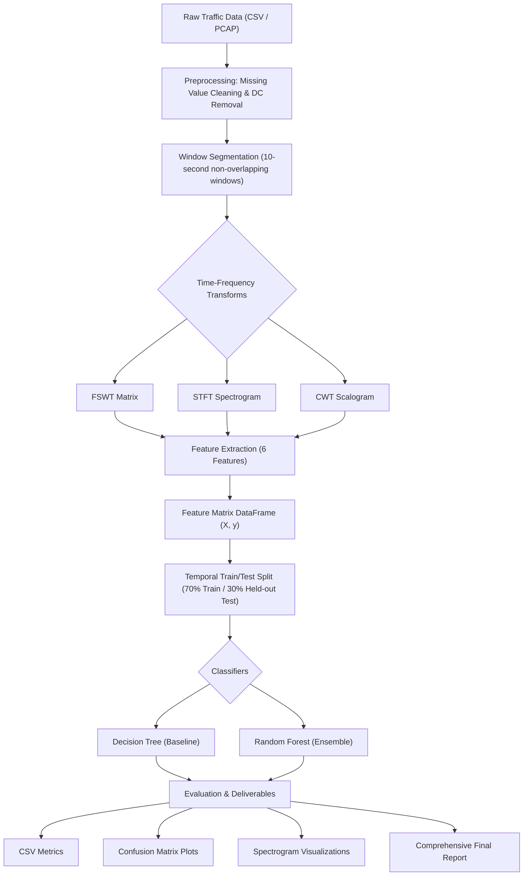

# Low-Rate Denial-of-Service (LDoS) Attack Detection Using Signal Transforms and Machine Learning

A complete, modular, student-friendly Python implementation for detecting low-rate Denial-of-Service attacks using time-frequency signal transforms (**FSWT**, **STFT**, **CWT**) and supervised machine learning (**Decision Tree**, **Random Forest**).

Designed for second-year B.Tech Information Technology students, researchers, and network security enthusiasts.

---

## Table of Contents
1. [What is an LDoS Attack?](#1-what-is-an-ldos-attack)
2. [Problem Statement](#2-problem-statement)
3. [End-to-End Pipeline Overview](#3-end-to-end-pipeline-overview)
4. [List of Abbreviations & Acronyms](#4-list-of-abbreviations--acronyms)
5. [Dataset Sources & Access](#5-dataset-sources--access)
6. [Project Folder Structure](#6-project-folder-structure)
7. [Detailed Explanation of All Six Features](#7-detailed-explanation-of-all-six-features)
8. [Detailed Explanation of the Three Transforms (FSWT, STFT, CWT)](#8-detailed-explanation-of-the-three-transforms)
9. [Machine Learning Models (Decision Tree & Random Forest)](#9-machine-learning-models)
10. [Windows & VS Code Setup Guide](#10-windows--vs-code-setup-guide)
11. [How to Run the Project](#11-how-to-run-the-project)
12. [Output Files, Metrics & Figures](#12-output-files-metrics--figures)
13. [Troubleshooting Common Issues](#13-troubleshooting-common-issues)
14. [Limitations, Ethical Use & Reproducibility](#14-limitations-ethical-use--reproducibility)

---

## 1. What is an LDoS Attack?

A **Low-Rate Denial-of-Service (LDoS)** attack (also known as a **Shrew attack** or **pulsing DoS**) is an evasive cyberattack that exploits network protocols—specifically **TCP's Retransmission Timeout (RTO)** and Congestion Control mechanisms—by periodically sending short, intense bursts of traffic rather than continuous high-volume floods.

### The Attack Mechanism
```text
Traffic Rate (Mbps)
 ^
 |        L (Burst Duration = 5s)
 |     +-------+                    +-------+                    +-------+
 |     | Burst |                    | Burst |                    | Burst |
 |     |  17M  |                    |  17M  |                    |  17M  |
 |     |       |                    |       |                    |       |
10 Mbps|-------+--------------------+-------+--------------------+-------+--- Normal Traffic
 |               <---- Idle = 10s ->
 |     <--------------- Attack Period T = 15s ------------------>
 +----------------------------------------------------------------------------> Time (s)
```

1. **The Pulse Phase ($L$):** The adversary sends high-rate packets for a very short duration $L$ (e.g., $1.0$s to $5.0$s). This momentarily congests the bottleneck router buffer, causing legitimate TCP connections to experience packet loss.
2. **TCP Reaction:** The sender enters Retransmission Timeout (RTO) state and resets its congestion window ($cwnd = 1$).
3. **The Idle Phase ($T - L$):** The attacker completely stops transmitting for $(T - L)$ seconds (e.g., $10$s). Just as legitimate TCP connections attempt to recover and increase their sending rate, the next attack pulse hits.
4. **Low Average Rate:** The average rate added to the network is minimal:
   $$\bar{R}_{\text{attack}} = \frac{L}{T} \cdot R_{\text{burst}}$$
   Because $\bar{R}_{\text{attack}}$ is so small, classical volume-based threshold intrusion detection systems (IDS) do not detect any anomaly!

---

## 2. Problem Statement

Time-domain threshold detectors fail because during $66.7\%$ of the time (the idle period), attack traffic is identical to normal background traffic. 

**Our Solution:** Transform 1D traffic signals into **2D Time-Frequency Energy Distributions** using:
1. **FSWT** (Frequency Slice Wavelet Transform — Original Baseline)
2. **STFT** (Short-Time Fourier Transform — Added Transform 1)
3. **CWT** (Continuous Wavelet Transform — Added Transform 2)

Extract 6 statistical, structural, and spectral features and classify them with **Decision Tree** and **Random Forest** classifiers.

---

## 3. End-to-End Pipeline Overview



---

## 4. List of Abbreviations & Acronyms

| Abbreviation | Full Meaning | Description |
| :--- | :--- | :--- |
| **LDoS** | Low-Rate Denial-of-Service | Pulsing, low-average-rate network attack targeting TCP RTO. |
| **FSWT** | Frequency Slice Wavelet Transform | Wavelet transform slicing Fourier spectrum via Gaussian windows. |
| **STFT** | Short-Time Fourier Transform | Windowed Fourier transform for time-localized spectral analysis. |
| **CWT** | Continuous Wavelet Transform | Multi-scale wavelet transform scaling a mother wavelet across time. |
| **RTO** | Retransmission Timeout | TCP timer waiting for unacknowledged packet recovery (often 1.0s). |
| **GLCM** | Gray-Level Co-occurrence Matrix | Matrix representing spatial/coordinate pixel relationships. |
| **DT** | Decision Tree | Tree-structured supervised learning classifier. |
| **RF** | Random Forest | Ensemble of bagged decision trees with feature subsampling. |
| **TP / TN** | True Positive / True Negative | Correctly flagged attack / correctly flagged normal window. |
| **FP / FN** | False Positive / False Negative | Normal falsely alarmed as attack / attack missed as normal. |
| **FPR** | False Positive Rate | $FP / (FP + TN)$ — lower is better. |

---

## 5. Dataset Sources & Access

This project supports two datasets:

### 1. Research Benchmark LDoS Dataset (Default)
- **Source:** Mathematical formulation from Xiaocai Wang et al. (*Expert Systems with Applications*, 2024).
- **Files:** `data/raw/benchmark_normal_traffic.csv` and `data/raw/benchmark_ldos_traffic.csv`.
- **Details:** 200 seconds of 10 Hz traffic (2,000 samples) featuring normal baseline traffic ($10$ Mbps, $\sigma=0.5$ Mbps) and LDoS pulses ($T=15$s, $L=5$s, $R=7$ Mbps).

### 2. UTSA-2021 Real SDN LDoS Dataset
- **Institution:** University of Texas at San Antonio (UTSA) Systems and Networks Lab.
- **Repository:** [`https://github.com/utsanetsys/UTSA-2021-Low-rate-DoS-Attack`](https://github.com/utsanetsys/UTSA-2021-Low-rate-DoS-Attack)
- **Automatic Download:** Executing `python main.py --dataset utsa` automatically downloads and extracts the raw `.pcap` archives (`1Client_PCAPs.zip` and `Benign_Only.zip`) and converts packet arrivals into continuous 10 Hz time-series signals using Scapy.

---

## 6. Project Folder Structure

```text
LDoS_Detection/
│
├── README.md                      # Comprehensive student project manual
├── requirements.txt               # Pinned Python dependencies
├── config.py                      # Centralized configuration & parameters
├── main.py                        # Pipeline runner for all 5 experiments
│
├── data/
│   ├── README.md                  # Dataset descriptions & license details
│   ├── raw/                       # Immutable raw traffic CSVs and PCAPs
│   └── processed/                 # Processed windowed feature datasets
│
├── src/
│   ├── __init__.py                # Package initialization
│   ├── dataset_loader.py          # Dataset download and loading routines
│   ├── preprocessing.py           # Missing value sanitization, DC removal, windowing
│   ├── signal_generation.py       # PCAP-to-signal and synthetic traffic generators
│   ├── fswt_transform.py          # Frequency Slice Wavelet Transform
│   ├── stft_transform.py          # Short-Time Fourier Transform
│   ├── cwt_transform.py           # Continuous Wavelet Transform
│   ├── contrast_feature.py        # Feature 1: Time-frequency contrast
│   ├── energy_ratio_feature.py    # Feature 2: Low-frequency energy ratio
│   ├── correlation_feature.py     # Feature 3: Time-frequency correlation
│   ├── entropy_feature.py         # Feature 4: Time-frequency Shannon entropy
│   ├── spectral_centroid_feature.py # Feature 5: Spectral centroid (frequency center of mass)
│   ├── kurtosis_feature.py        # Feature 6: Temporal energy profile kurtosis
│   ├── feature_extraction.py      # Feature combiner into pandas DataFrames
│   ├── decision_tree_model.py     # Decision Tree classifier pipeline
│   ├── random_forest_model.py     # Random Forest ensemble classifier pipeline
│   ├── evaluation.py              # Metric calculation, CSV export, report generation
│   └── visualization.py           # Publication-ready figure plotting
│
├── tests/
│   ├── test_features.py           # Unit tests for all 6 features (including edge cases)
│   ├── test_transforms.py         # Unit tests for FSWT, STFT, and CWT
│   └── test_dataset.py            # Unit tests for dataset loader and preprocessing
│
└── results/
    ├── README.md                  # Documentation of results and outputs
    ├── figures/                   # PNG plots (time-domain, spectrograms, confusion matrices)
    ├── metrics/                   # CSV tables with quantitative metrics
    └── reports/                   # Markdown final experimental report
```

---

## 7. Detailed Explanation of All Six Features

All features operate on the normalized 2D time-frequency energy distribution matrix:
$$P(i, j) = \frac{E(i, j)}{\sum_{i, j} E(i, j)}$$

### 1. Contrast (`contrast_feature.py` — Original)
- **Plain English:** Measures the spread and intensity difference between neighboring coordinates in the time-frequency plane.
- **Why it works:** LDoS rectangular pulses create sudden, sharp transitions and localized hotspots, producing significantly higher contrast than smoothly fluctuating normal traffic.
- **Formula:**
  $$\text{Contrast} = \sum_{i} \sum_{j} (i - j)^2 \cdot P(i, j)$$

### 2. Energy Ratio (`energy_ratio_feature.py` — Original)
- **Plain English:** Calculates the fraction of total spectral energy concentrated in low frequencies ($\le f_s / 10 = 1.0$ Hz).
- **Why it works:** An LDoS attack repeats at period $T$ (fundamental frequency $f = 1/T \approx 0.067$ Hz). The bulk of attack energy concentrates in this low-frequency band.
- **Formula:**
  $$\text{Energy Ratio} = \frac{\sum_{|f| \le 1.0\text{Hz}} E(f, t)}{\sum_{\text{all } f} E(f, t)}$$

### 3. Correlation (`correlation_feature.py` — Original)
- **Plain English:** Evaluates linear dependency and temporal-spectral alignment across matrix bins.
- **Why it works:** LDoS pulse bursts cause spectral energy to rise and fall predictably together over time (high correlation), whereas normal noise has random, uncorrelated scatter.
- **Formula:**
  $$\text{Correlation} = \frac{\sum_{i, j} i \cdot j \cdot P(i, j) - \mu_1 \mu_2}{\sqrt{\sigma_1^2 \sigma_2^2} + \epsilon}$$

### 4. Entropy (`entropy_feature.py` — Original)
- **Plain English:** Measures the disorder, randomness, or dispersion of energy across the spectrum.
- **Why it works:** Normal traffic noise is spread diffusely across many frequency bins (high entropy). When an attack occurs, energy collapses onto discrete pulse harmonic frequencies, sharply lowering entropy.
- **Formula:**
  $$\text{Entropy} = -\sum_{P(i, j) > 0} P(i, j) \cdot \ln(P(i, j))$$

### 5. Spectral Centroid (`spectral_centroid_feature.py` — Added Feature 1)
- **Plain English:** Identifies the "center of mass" or energy-weighted mean frequency of the signal.
- **Why it works:** Normal wideband noise contains substantial energy at mid-to-high frequencies (higher centroid). LDoS pulses pull the center of mass down into low frequencies.
- **Formula:**
  $$\text{Spectral Centroid} = \frac{\sum_k |f_k| \cdot \sum_t E(f_k, t)}{\sum_{k, t} E(f_k, t)}$$

### 6. Kurtosis (`kurtosis_feature.py` — Added Feature 2)
- **Plain English:** Measures the "peakedness" and presence of heavy tails / outliers in the temporal energy profile.
- **Why it works:** Normal traffic exhibits a bell-shaped Gaussian distribution (excess kurtosis $\approx 0$). LDoS pulsing introduces extreme, intermittent energy bursts, yielding high positive kurtosis (leptokurtic).
- **Formula:**
  $$\text{Kurtosis} = \frac{\frac{1}{N} \sum_{t=1}^N (z_t - \mu)^4}{\sigma^4} - 3.0 \quad \text{where } z_t = \sum_f E(f, t)$$

---

## 8. Detailed Explanation of the Three Transforms

### A. Frequency Slice Wavelet Transform (FSWT — Baseline)
- Slices the Fourier spectrum using a scalable Gaussian Frequency Slice Function (FSF):
  $$\hat{p}(\omega) = \exp(-0.5 \omega^2) \quad \text{with bandwidth } \sigma = |f| / \kappa$$
- Computes coefficients in the frequency domain:
  $$W(i, t) = \lambda \cdot \text{IFFT}\{X(f) \cdot P_i^*(f)\}$$
- Produces high-resolution time-frequency energy matrices tailored for discrete harmonic tracking.

### B. Short-Time Fourier Transform (STFT — Added Transform 1)
- Slides a fixed-length window function $w[n]$ (Hann window) along the time series and performs standard discrete Fourier transforms:
  $$\text{STFT}(m, \omega) = \sum_n x[n] w[n - m] e^{-j \omega n}$$
- Provides uniform time-frequency resolution across all frequency bands.

### C. Continuous Wavelet Transform (CWT — Added Transform 2)
- Correlates the signal with dilated and translated versions of a Morlet mother wavelet $\psi(t)$:
  $$\text{CWT}(a, b) = \frac{1}{\sqrt{|a|}} \int_{-\infty}^{\infty} x(t) \psi^*\left(\frac{t - b}{a}\right) dt$$
- Provides multiresolution analysis: high temporal resolution for fast transients, high spectral resolution for low-frequency trends.

---

## 9. Machine Learning Models

### Decision Tree (Baseline)
- Evaluates recursive binary splits using Gini impurity.
- Fixed at `max_depth=3` to guarantee high interpretability and prevent overfitting on small traffic windows.

### Random Forest (Added Model)
- An ensemble of 100 decorrelated decision trees (`n_estimators=100`, `max_depth=5`).
- Combines predictions through majority voting, suppressing individual tree variance and false alarms.

---

## 10. Windows & VS Code Setup Guide

### Step 1: Open the Project in VS Code
Open VS Code, press `Ctrl+O` (or `File -> Open Folder...`), and select the `LDoS_Detection` directory.

### Step 2: Open a PowerShell Terminal
In VS Code, press `Ctrl+\`` (or `Terminal -> New Terminal`).

### Step 3: Activate the Virtual Environment
```powershell
.\venv\Scripts\Activate.ps1
```
*(If PowerShell displays an execution policy warning, run `Set-ExecutionPolicy -ExecutionPolicy RemoteSigned -Scope CurrentUser` once).*

### Step 4: Verify Installation
```powershell
python -c "import numpy, scipy, sklearn, pandas, matplotlib, pywt, scapy; print('All libraries verified!')"
```

---

## 11. How to Run the Project

### Run Unit Tests
```powershell
python -m pytest tests -v
```
All 15 tests verify feature safety, transform validity, and preprocessing consistency.

### Run Main Experimental Pipeline (Benchmark Dataset)
```powershell
python main.py --dataset benchmark --split temporal
```

### Run Main Experimental Pipeline (Real UTSA SDN Dataset)
```powershell
python main.py --dataset utsa --split temporal
```

---

## 12. Output Files, Metrics & Figures

After execution, all deliverables are saved automatically:

1. **Terminal Output:** Displays live execution steps, timing, and the final comparison table.
2. **CSV Metrics:** Saved in [`results/metrics/all_experiments_metrics.csv`](results/metrics/all_experiments_metrics.csv).
3. **Figures:** Saved in `results/figures/`:
   - `time_domain_signals.png`: Raw Normal vs LDoS time series.
   - `transform_comparisons.png`: 3x2 comparison grid of FSWT, STFT, and CWT spectrograms.
   - `feature_distributions.png`: Boxplots comparing each feature across classes.
   - `all_confusion_matrices.png`: Annotated 2x3 confusion matrix grid for all 5 experiments.
4. **Final Technical Report:** Saved in [`results/reports/final_report.md`](results/reports/final_report.md).

---

## 13. Troubleshooting Common Issues

1. **`ModuleNotFoundError`:**  
   Ensure the virtual environment is activated (`.\venv\Scripts\activate`) or run using `.\venv\Scripts\python.exe main.py`.
2. **`AttributeError: 'PacketMetadataNg' object has no attribute 'sec'`:**  
   Handled automatically by `src/signal_generation.py`, which supports both classic PCAP and newer PCAP-NG formats.
3. **`No libpcap provider available` Warning:**  
   Safe warning from Scapy on Windows when WinPcap/Npcap is not installed. Scapy automatically uses Python native file reading.

---

## 14. Limitations, Ethical Use & Reproducibility

- **Limitations:** LDoS attacks in idle periods have traffic identical to normal traffic. Detecting attack presence requires observing at least one pulse transition within the window length $N$.
- **Ethical Use:** This codebase is developed strictly for defensive research, student education, and network security testing. Do not use for unauthorized penetration testing.
- **Reproducibility:** All seeds are fixed (`RANDOM_STATE = 42`), and exact package versions are pinned in `requirements.txt`.
